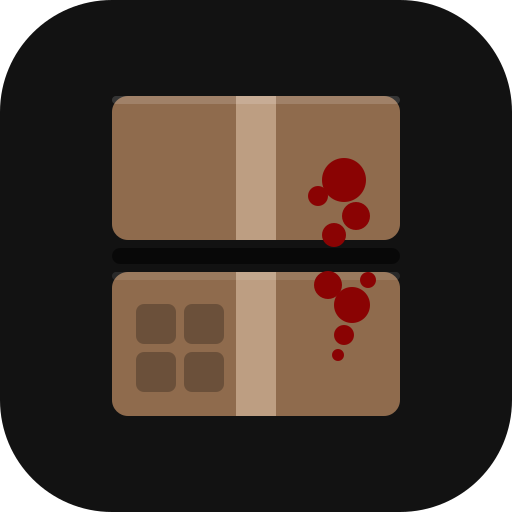

  
  
  
  
  

# ZomboidDS

Nintendo DS-style play for Project Zomboid on dual-screen Android devices, like the AYN Thor or
a foldable phone. The game runs on the top screen (through
[Zomdroid](https://github.com/udarmolota/zomdroid)); the **ZomboidDS Companion** app on the bottom
screen, in the game's art:

- **Inventory**: your bags and every container around you, with the game's icons; move items with a
  tap or by dragging, and use them through their menu (read, eat, apply, craft, ...).
- **Here**: what you can do where you stand (open, sit, drink, ...); in a car, the car's own menu.
- **Deck**: the speed buttons, the time, and your own commands: zoom, search mode, flashlight,
  map, your hotbar weapons, your watch's alarm, ...
- **Status**: your moodles, your body with its injuries, and how to treat them.
- **Craft**: the recipes you can make with what's in reach, what each needs, and crafting them.
- **Build**: the build menu (Craft ▾ → Build); pick something, then place it on the top screen with
  the controller.
- **Tailor**: your clothes with their holes and patches (Craft ▾ → Tailor), and the Inspect view to
  patch them part by part.
- **Vehicle**: while you drive, speed, engine and fuel with the car's controls.

## Install

You need your own copy of **Project Zomboid (Build 42)**, running in
[udarmolota's Zomdroid](https://github.com/udarmolota/zomdroid). ZomboidDS is an unofficial mod,
not affiliated with or endorsed by The Indie Stone.

1. Download `ZomboidDS-<version>.apk` from the
   [latest release](https://github.com/Space001000/ZomboidDS/releases/latest) and install it.
2. Open **ZomboidDS**. Its setup checklist walks you through the rest, and each step turns ✓ when
   it's done:
   - **Grant access** to Zomdroid's folder (tap **Use this folder**, then **Allow**).
   - **ZombieBuddy**: tap **Download**, then **Open Zomdroid**, go to **Optimization →
     ZombieBuddy** and install the `ZombieBuddy-…-full.zip` from your Downloads.
   - **Install** the ZomboidDS mod, and **Enable** it for new games.
3. Start a new game in Zomdroid on the top screen, with ZomboidDS on the bottom screen.

The app tells you when there's a new version. The [user guide](docs/USER_GUIDE.md) has every step in
detail, launching both screens together with Cocoon, how to use each tab, and troubleshooting.

**Build 42.21** needs ZombieBuddy 2.3.4 or newer (2.3.3 can't load Java mods there). The app
downloads 2.3.4, and its checklist offers **Update** when you have an older one.

## Community

Questions, bug reports, screenshots of your runs, or ideas for the next tab: come say hi on the
[ZomboidDS Discord](https://discord.gg/NEJeAHgWss). Bugs can also go in
[GitHub issues](https://github.com/Space001000/ZomboidDS/issues).

## Support

ZomboidDS is free and stays free: donations never unlock anything. If it makes your runs better and
you'd like to say thanks: [ko-fi.com/space000](https://ko-fi.com/space000).

## Privacy

ZomboidDS talks to the game on your own device and nowhere else. The only time it goes online is to
check GitHub for app updates and to download ZombieBuddy when you ask. No analytics, no accounts.
The details, and every permission it asks for, are in
[What the app can access](docs/DEVELOPMENT.md#what-the-app-can-access).

## Under the hood

ZomboidDS is a Lua + Java mod inside the game and a Kotlin + Compose app on the second screen,
talking over a local WebSocket. How it fits together, building it, tests and device tips are in
[docs/DEVELOPMENT.md](docs/DEVELOPMENT.md); the design is in [docs/DESIGN.md](docs/DESIGN.md).

## Credits

- [Zomdroid](https://github.com/udarmolota/zomdroid) runs Project Zomboid on Android.
- [ZombieBuddy](https://github.com/zed-0xff/ZombieBuddy) (MIT) loads the mod's Java code and
  exposes it to Lua.

Not affiliated with The Indie Stone. ZomboidDS ships no game files; icons are read from the
player's own installation on their device.

## Licence

ZomboidDS is free software under the [GNU General Public License v3.0](LICENSE): you may use, study,
share and change it, and versions you distribute must stay under the same licence. The open-source
software it includes, and their licences, are listed in [THIRD_PARTY_NOTICES.md](THIRD_PARTY_NOTICES.md)
(also in the app: About → Open-source licences).
